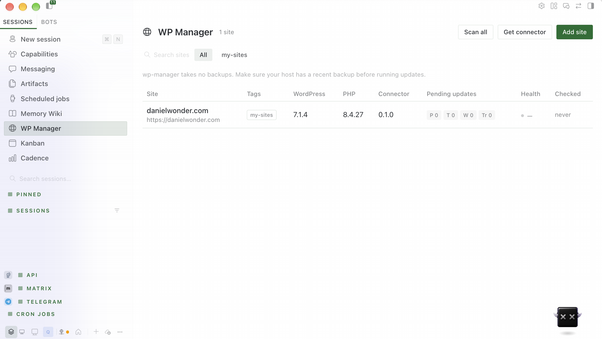
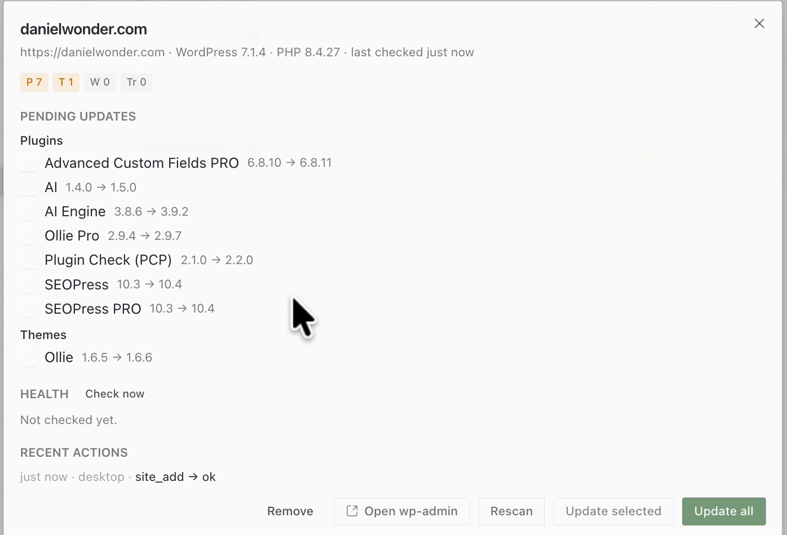
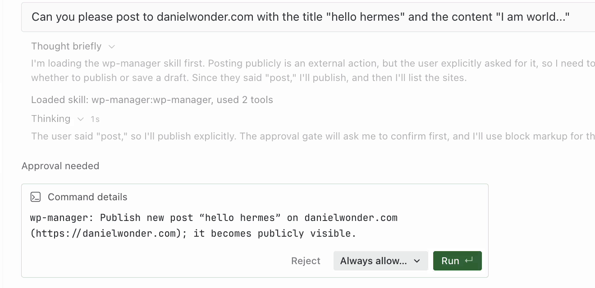

# WP Manager for Hermes

Look after your WordPress sites from [Hermes Agent](https://hermes-agent.nousresearch.com/):
see which plugins, themes, translations and WordPress versions need updating, install updates
after you approve them, check that each site still works afterwards, and write or edit posts and
pages from chat.

Use it for routine site maintenance and content editing. It does not provide backups,
client reports, staging sites or malware scans.

> **⚠️ wp-manager takes no backups.** Before you run updates, especially across many sites, make
> sure your host has a recent backup you know how to restore. After every update run, wp-manager
> checks the site and tells you plainly if something broke. It cannot undo the update.

**Demo (88 s):** [watch on X](https://x.com/danielwonder/status/2119334033226088695)



| Pending updates for a site | Publishing asks first |
|---|---|
|  |  |

## What you get

- **Chat tools** (toolset `wp_manager`): `wp_sites`, `wp_site_add`, `wp_site_remove`,
  `wp_updates_scan`, `wp_update_apply`, `wp_health_check`, `wp_content_list`, `wp_content_get`,
  `wp_content_save`.
- **A WP Manager page in Hermes Desktop**: all your sites in one table (versions, pending updates,
  health, last check), with buttons to scan, update, add sites and download the connector.
- **The connector**: a small WordPress plugin, *Website Manager: WP Connector for Hermes*, that
  you install on each site. It lives in `connector/website-manager-hermes-connector/`.
- **A built-in skill** that teaches the agent the safe way to run updates and to edit block-editor
  content without breaking page layouts.

## Requirements

- Hermes Agent 0.22.5 or newer.
- WordPress 6.5+ on PHP 7.4+, served over **https** (plain http is refused unless you opt in for
  that site; `localhost` is fine for testing).
- An administrator account on each site.
- Optional, for the **1Password** storage option: the 1Password CLI (`op`) installed and signed in
  on the machine where Hermes runs. See [Set up the 1Password CLI](#set-up-the-1password-cli).

## Install

```bash
hermes plugins install danieljwonder/wp-manager --enable
```

Then restart Hermes (or the gateway) so the backend for the Desktop page loads. Hermes only loads
a plugin's backend when the plugin is in `plugins.enabled`.

In Hermes Desktop, open **Capabilities → Plugins** and switch on **WP Manager (wp-manager)**.
A **WP Manager** item appears in the sidebar, and **WP Manager: Scan all sites** appears in ⌘K.

### Using Desktop with a remote Hermes (Umbrel, a server, a VPS)

If your Desktop app connects to Hermes running on another machine, the plugin's backend runs over
there, but the Desktop page must also exist on the computer running Desktop. Install it with
**Capabilities → Plugins → Install from Git** and tick the Desktop target, or copy
`desktop/plugin.js` to `$HERMES_HOME/desktop-plugins/wp-manager/plugin.js` on that computer
(`~/.hermes/desktop-plugins/wp-manager/plugin.js` by default). Install the plugin itself
(`hermes plugins install …`) on the remote Hermes.

## Connect a site

1. **Install the connector on the site.** In Desktop, the WP Manager page's **Get connector**
   button saves the plugin zip. On the site, go to **Plugins → Add New → Upload Plugin**, choose
   the zip, then install and activate it.
2. **Create a connection.** In wp-admin, open **Tools → Hermes Connector** and click **Create
   connection for Hermes**. WordPress creates an
   [Application Password](https://make.wordpress.org/core/2020/11/05/application-passwords-integration-guide/)
   called "Hermes (website-manager)" and shows a one-time connection string starting with `wpmh1:`.
   Copy it. It is shown only once.
3. **Add the site in Hermes Desktop.** Open **WP Manager → Add site**, paste the connection string
   and choose where the password is kept: **1Password** (a new item in a vault you pick) or
   **Existing Hermes secret / 1Password reference**. Then click **Connect**. Hermes checks the
   connection, saves the site, and tells you where the password is kept.

Please paste connection strings into the Desktop dialog, not into chat. A string pasted into chat
ends up in the conversation history.

Opening a site's details automatically loads its pending update items if they have not been
loaded yet. The dialog keeps the known summary counts visible while loading. This first load
reads the site's cached WordPress update offers; it does not install updates or force WordPress
to refresh its update checks. **Rescan** explicitly refreshes those checks. Failed loads show an
error and **Retry**, not an all-clear message. Update controls stay disabled until a usable item
list is available. Health remains **Not checked yet** until you run a health check separately.

You can revoke access at any time: in wp-admin, go to **Users → Profile → Application
Passwords** and revoke "Hermes (website-manager)". wp-manager never uses or asks for your
WordPress login password.

## Where the password is kept

Each site record in `$HERMES_HOME/wp-manager/sites.json` holds the site address, username and a
*reference* to the Application Password. It never holds the password itself. wp-manager looks up
the password through Hermes's own secret handling each time it needs it.

**Recommended for connection strings: 1Password.** The backend lists vault names and IDs only,
using the trusted `op_binary` configured on the Hermes machine. Choose a vault explicitly.
The CLI must already be authenticated and allowed to create/read items in that vault. A service
account wrapper can be configured as `op_binary`; keep its token in Hermes secrets, not settings.
wp-manager creates a **new** Login item (never overwrites an item), passes the password only as
JSON on subprocess stdin, reads `op://<vault ID>/<item ID>/password` back, checks exact equality,
and authenticates against the original validated WordPress address before saving the site.
It stores only that ID-based reference in the registry. CLI errors/output never enter errors or logs.
If CLI access is unavailable this option is disabled, with Retry. Creation, read-back or WordPress
authentication failure leaves the registry unchanged and **never falls back to .env**. A failed
attempt may leave a newly created item in 1Password; remove that item manually before retrying.
There is no automatic migration of existing sites or deletion of vault items.

**Existing Hermes secrets:** Hermes can read secrets from
1Password, Bitwarden or your own helper command. Put the Application Password in your vault, then
map it to the site's secret name. The name is `WPM_<SITE_ID>_APP_PASSWORD`, where the site id is
in upper case with `-` turned into `_`:

```bash
hermes secrets onepassword set WPM_MYSHOP_APP_PASSWORD "op://Private/My Shop WordPress/app password"
```

Restart Hermes so it picks up the new secret. Hermes resolves secret sources at startup. Then add
the site with only its address and username: in Desktop choose **Add site → Enter details →
Hermes secret**, or ask the agent ("add https://myshop.example as user admin"). See the Hermes
docs for [1Password](https://hermes-agent.nousresearch.com/docs/user-guide/secrets/onepassword),
[Bitwarden](https://hermes-agent.nousresearch.com/docs/user-guide/secrets/bitwarden) and
[command helpers](https://hermes-agent.nousresearch.com/docs/user-guide/secrets/command).

**Also supported:**

- A direct 1Password reference per site (`op://Vault/Item/field`). Hermes runs the `op` CLI on the
  Hermes machine whenever it needs the password. The `op_binary` setting names the program.

**No password manager?** wp-manager never writes the Hermes `.env` file itself. If you want to
keep the password there, add the line yourself (`WPM_<SITE_ID>_APP_PASSWORD=...` in
`$HERMES_HOME/.env`), restart Hermes, then add the site with **Enter details → Hermes secret**.
Hermes reads it like any other secret.

### Set up the 1Password CLI

The **1Password** option in **Add site** needs the 1Password CLI on the machine (or container)
where Hermes runs. Hermes's own 1Password integration (`hermes secrets onepassword ...`) can only
*read* secrets that you map by hand. Creating a new item for a site goes through the CLI.

1. Install `op` by following 1Password's
   [Get started with 1Password CLI](https://developer.1password.com/docs/cli/get-started/) guide.
2. Sign it in for the user Hermes runs as:
   - **On your own computer:** turn on the 1Password desktop app integration (or run
     `op signin`), so `op vault list` works in a terminal.
   - **On a server, Umbrel or Docker:** create a
     [1Password service account](https://developer.1password.com/docs/service-accounts/) with
     access to one vault (for example "Agents"). Point the `op_binary` setting at a small wrapper
     script that supplies the token to `op`. Keep the token in Hermes secrets, not in settings.
3. Check it: `op vault list` (or your wrapper with `vault list`) shows the vault you want.
4. In Desktop, open **Add site**. If the vault list doesn't load, click **Retry vault access**.

Passwords never appear in tool results, logs, `state.json`, the action log or error messages.

## Approvals and safety

- **Updates always ask first.** `wp_update_apply` goes through Hermes's normal approval prompt
  (once / for this session / always / deny). "Always" applies to one site only: the approval
  rule is `wp-manager:update:<site>`.
- **Publishing asks first.** New posts and pages are saved as drafts. Publishing, or changing a
  post or page that is already live, asks for approval (`wp-manager:publish:<site>`).
- **Pointing a new site at an existing secret asks first.** This covers a 1Password reference or
  another site's secret name, because that sends the secret to the new address
  (`wp-manager:credential:<site>`).
- **Creating a new 1Password item from a tool asks first** (`wp-manager:credential-store:<site>`)
  and is blocked unattended. In Desktop, choosing storage/vault and pressing Connect is approval.
- **With approval required (the default), unattended updates and publishing are blocked.**
  Cron jobs and webhook sessions cannot approve these actions. Disabling `require_approval`
  removes those guards. Draft creation is not gated. Scans and health checks still work, so a
  scheduled "scan and tell me what's pending" job is fine.
- **The Desktop "Update" buttons count as your approval.** They call the backend directly and
  show their own confirmation dialog.
- **After every update run, a health check runs.** It loads the home page (status code, response
  time, "critical error" text), the REST API, and the connector's self-report (fatal errors,
  paused plugins, recovery mode, database). If the verdict is *degraded* or *down*, the result
  says so loudly and the update is not reported as a success.
- **Plain `http://` sites are refused** unless you set `allow_insecure` for that site. Credentials
  are never sent along a redirect to a different host.
- **Every change is logged** to `$HERMES_HOME/wp-manager/actions.jsonl`: site added or removed,
  updates, content saves. The log contains no secrets.

## Settings

Change these in the plugin's settings in Hermes, or under `plugins.entries.wp-manager.settings`
in `config.yaml`:

| Setting | Default | What it does |
|---|---|---|
| `require_approval` | `true` | Ask before updates, publishing and editing published content. Turning it off also allows those actions in cron. |
| `op_binary` | `op` | Trusted 1Password CLI for reference reads, vault metadata and explicit item creation. |
| `request_timeout` | `60` | Seconds per request. Update runs use at least 300. |
| `max_parallel` | `4` | Sites scanned at the same time. |

## Things to ask the agent

- "Which of my WordPress sites need updates?"
- "Update Hello Dolly on the shop site." (Hermes asks you to approve.)
- "Is clientsite.com healthy?"
- "Draft a blog post on myblog about our autumn opening hours."
- "Fix the typo in the second paragraph of the About page." The agent reads the page first. Page
  builder layouts (Elementor and similar) are left alone and you are told to use wp-admin.

## What gets sent where

wp-manager talks only to the WordPress sites you add, using the WordPress REST API with the
site's Application Password. It also runs the `op` CLI (the `op_binary` setting) on the Hermes
machine for `op://` references, vault names and explicitly selected 1Password item creation. That
CLI talks to 1Password under your own account or service account.
It reads and writes only its own folder, `$HERMES_HOME/wp-manager/`, and never reads or writes
the Hermes `.env` file. It makes no other network calls and sends no telemetry. The connector only contacts WordPress.org's
normal update service.

## Development

```bash
(cd tests && python -m unittest)   # use the Hermes Python environment
hermes plugins validate .         # validate a clean checkout
hermes plugins doctor . --ci      # runtime registration checks
```

See [architecture](docs/architecture.md), the [connector API](docs/connector-api.md), and
[testing](docs/testing.md) for dependencies, fixture provenance, recorded evidence and known
gaps. `scripts/record_fixtures.py` records responses from a disposable WordPress;
[the Playground harness](e2e/README.md) provides one. Desktop rendering, the connector
download and live 1Password item creation were verified manually against a live site (see the
demo); [testing](docs/testing.md) lists what has not been tried yet. Unit tests are not a security audit. Host-isolated backend calls
can time out while an update continues: scan and check health before retrying a write.

The Python plugin is MIT licensed. The WordPress connector is GPLv2-or-later.
